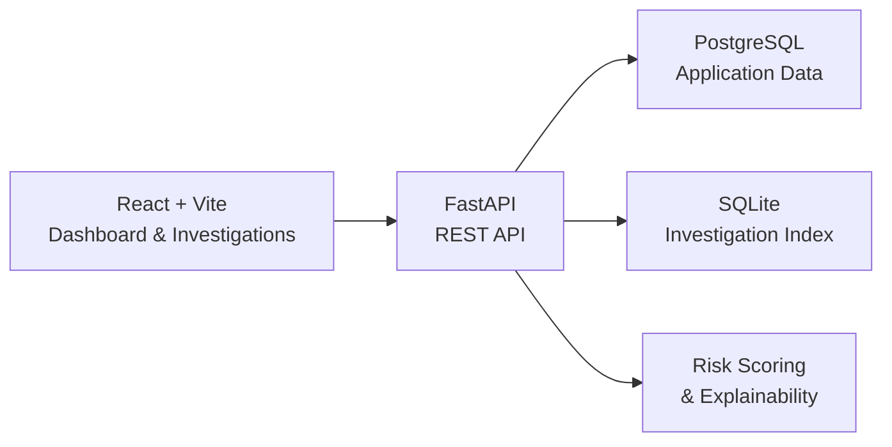

# AMLNet

**Graph-Based Anti-Money Laundering Detection & Financial Intelligence**

[](LICENSE)

**[Explore the Live Application](https://amlnet.vercel.app)**

AMLNet is a full-stack financial crime analytics application built around synthetic transaction networks. It combines account risk analysis, transaction investigation, graph visualization, explainable predictions and model comparisons in a single interactive workspace.

---

## Features

- **Multi-scale datasets** — Explore five AMLSim-derived network sizes, from 100 to 1 million source accounts, with **100K as the default**.
- **Account investigations** — Search account profiles and filter by Low, Medium, High and Critical risk levels.
- **Transaction intelligence** — Examine transfers, account activity and suspicious-activity indicators.
- **Interactive Graph Explorer** — Follow directed fund flows and explore connected account neighborhoods.
- **Risk analysis and explainability** — Review risk scores, model comparisons and the signals behind flagged accounts.
- **Passkey security** — WebAuthn authentication and authorization for supported administrative workflows.

## Technology Stack

| Component | Technologies |
| --- | --- |
| Frontend | React, Vite, Recharts, Cytoscape.js |
| Backend | Python, FastAPI |
| Data storage | PostgreSQL, SQLite |
| Machine learning | PyTorch, PyTorch Geometric, scikit-learn |
| Hosting | Vercel, Render |

## Architecture



## Dataset Coverage

AMLNet uses synthetic financial networks at five scales.

| Dataset Tier | Source Accounts | Source Transactions |
| --- | ---: | ---: |
| 100 | 100 | 17,144 |
| 1K | 1,000 | 117,533 |
| 10K | 10,000 | 1,323,234 |
| **100K (Default)** | **100,000** | **12,476,012** |
| 1M | 1,000,000 | 124,703,184 |
| **Total** | **1,111,100** | **138,637,107** |

The full source data and the interactive investigation index are different scopes. For example, the default 100K tier uses an indexed investigation cohort of **25,000 accounts** and **35,000 transaction edges** for responsive exploration. Account features were aggregated from source transactions, while graph training uses sampled edges rather than the entire source topology.

---

## Quick Start

**Requirements:** Python 3.11+, Node.js 20+ and npm.

Clone the repository:

```bash
git clone https://github.com/AniketAgarwal-aa/AMLNet.git
cd AMLNet
```

**Backend** — in the first terminal:

```bash
cd backend
python3 -m venv .venv
source .venv/bin/activate
python -m pip install -r requirements.txt
uvicorn app.main:app --reload --port 8000
```

**Frontend** — in a second terminal, from the repository root:

```bash
cd frontend
npm ci
npm run dev
```

Open **[http://localhost:5173](http://localhost:5173)**. Some features require the appropriate database and environment configuration.

## Testing

From the repository root, run:

```bash
cd backend
python -m pytest -q

cd ../frontend
npm ci
npm test
npm run build
```

---

## License & Attribution

- **License:** [MIT License](LICENSE)
- **Dataset attribution:** Synthetic benchmark datasets derived from [IBM AMLSim](https://github.com/IBM/AMLSim).

