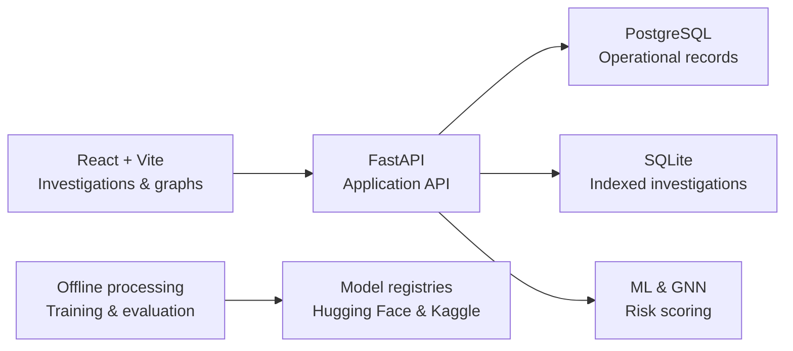

# AMLNet

**Graph-Based Anti-Money Laundering Detection & Financial Intelligence**

[](#models)
[](LICENSE)

**[Live Application](https://amlnet.vercel.app)**

AMLNet is a full-stack application for exploring suspicious behavior in synthetic financial transaction networks. It brings together graph analytics, machine-learning risk scoring, account investigations and interactive visualizations. Detection scores help prioritize reviews; they do not establish criminal activity.

## Features

- **Dataset explorer:** Five AMLSim-derived tiers, from 100 to 1 million accounts, with **100K selected by default**.
- **Account intelligence:** Search, inspect and filter accounts across Low, Medium, High and Critical risk levels.
- **Transaction analysis:** Explore account transfers, suspicious activity signals and investigation details.
- **Graph Explorer:** Visualize directed fund flows, connected neighborhoods and risk-coded entities.
- **Model evaluation:** Compare GCN, GraphSAGE, GAT, Logistic Regression, Random Forest and HistGradientBoosting.
- **Security:** Administrative authorization and WebAuthn/passkey-based authentication flows.

## Technology Stack

| Layer | Technologies |
| --- | --- |
| Frontend | React, Vite, Recharts, Cytoscape.js |
| API | Python, FastAPI |
| Data | PostgreSQL, SQLite, pandas, NumPy |
| Machine Learning | PyTorch, PyTorch Geometric, scikit-learn |
| Deployment | Vercel, Render |

## Architecture



## Datasets

AMLNet supports five synthetic benchmark tiers. The selected **source dataset** and the smaller **interactive investigation index** are distinct.

| Tier | Source Accounts | Source Transactions |
| --- | ---: | ---: |
| 100 | 100 | 17,144 |
| 1K | 1,000 | 117,533 |
| 10K | 10,000 | 1,323,234 |
| **100K (default)** | **100,000** | **12,476,012** |
| 1M | 1,000,000 | 124,703,184 |
| **Total** | **1,111,100** | **138,637,107** |

For the default 100K tier, the interactive index contains **25,000 accounts and 35,000 retained transaction edges**. Source transactions were streamed for feature aggregation; GNN training uses sampled graph edges rather than every source edge.

## Models

**30 model configurations:** Six architectures across five dataset tiers.

| Model Family | Architectures | Registry |
| --- | --- | --- |
| Graph Neural Networks | GCN, GraphSAGE, GAT | [Kaggle — PyTorch](https://www.kaggle.com/models/aniketagarwal10aa/amlnet/PyTorch/gnn-architectures) |
| Classical ML | Logistic Regression, Random Forest, HistGradientBoosting | [Kaggle — Scikit-learn](https://www.kaggle.com/models/aniketagarwal10aa/amlnet/ScikitLearn/tabular-baselines) |

The model collection is also available on **[Hugging Face](https://huggingface.co/AniketAgarwal-aa/AMLNet-Research)** and **[Kaggle](https://www.kaggle.com/models/aniketagarwal10aa/amlnet)**.

## Quick Start

**Prerequisites:** Python 3.11+, Node.js 20+ and npm. Some features require environment configuration and database access.

```bash
git clone https://github.com/AniketAgarwal-aa/AMLNet.git
cd AMLNet
```

**Start the backend** (terminal 1):

```bash
cd backend
python3 -m venv .venv
source .venv/bin/activate
python -m pip install -r requirements.txt
uvicorn app.main:app --reload --port 8000
```

**Start the frontend** (terminal 2, from the project root):

```bash
cd frontend
npm ci
npm run dev
```

Open **[http://localhost:5173](http://localhost:5173)**.

## Testing

Run from the repository root:

```bash
cd backend
python -m pytest -q
cd ../frontend
npm ci
npm test
npm run build
```

## Notes

- Dataset accounts, transactions and labels are synthetic.
- Large-tier interactive indexes and sampled training graphs are smaller than their source datasets.
- Model performance on synthetic data does not establish real-world financial crime detection accuracy.
- Technical architecture: [Architecture Notes](docs/ARCHITECTURE.md).

## License & Attribution

- **AMLNet:** [MIT License](LICENSE).
- **Dataset generator:** [IBM AMLSim](https://github.com/IBM/AMLSim) (Apache-2.0); its license applies separately.
