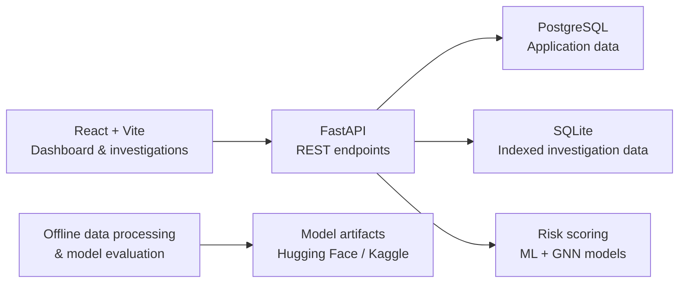

# AMLNet

**Graph-based anti-money-laundering detection and financial intelligence**

[](https://github.com/AniketAgarwal-aa/AMLNet/actions/workflows/ci.yml)
[](https://github.com/AniketAgarwal-aa/AMLNet/releases/latest)
[](LICENSE)
[](https://www.kaggle.com/models/aniketagarwal10aa/amlnet)

[**Live application**](https://amlnet.vercel.app) · [**API documentation**](https://amlnet-api.onrender.com/docs) · [**Latest release**](https://github.com/AniketAgarwal-aa/AMLNet/releases/latest) · [**Hugging Face**](https://huggingface.co/AniketAgarwal-aa/AMLNet-Research) · [**Kaggle Models**](https://www.kaggle.com/models/aniketagarwal10aa/amlnet)

AMLNet explores suspicious activity in synthetic financial transaction networks. It combines transaction analytics, graph visualization, machine-learning risk scoring and account-level investigations in a React and FastAPI application. Risk indicators are investigative signals, **not proof of financial crime**.

## Highlights

- **Five dataset tiers:** 100, 1K, 10K, **100K (default)** and 1M source accounts.
- **Investigations:** Browse accounts, transactions, suspicious-activity signals and model explanations with dataset-aware filters.
- **Graph Explorer:** Inspect directed money flows, connected neighborhoods and account risk levels.
- **Model comparison:** GCN, GraphSAGE and GAT alongside Logistic Regression, Random Forest and HistGradientBoosting.
- **Security:** Administrative endpoints and passkey-based flows with server-side access checks.

## Application architecture



| Layer | Technologies |
| --- | --- |
| Frontend | React, Vite, Recharts, Cytoscape.js |
| Backend | Python, FastAPI |
| Data | PostgreSQL, SQLite, pandas, NumPy |
| Machine learning | PyTorch, PyTorch Geometric, scikit-learn |
| Deployment | Vercel (frontend), Render (API) |

## Dataset coverage

AMLNet uses synthetic AMLSim-derived datasets. The source dataset size and the smaller interactive investigation index are **different scopes**.

| Tier | Source accounts | Source transactions |
| --- | ---: | ---: |
| 100 | 100 | 17,144 |
| 1K | 1,000 | 117,533 |
| 10K | 10,000 | 1,323,234 |
| **100K (default)** | **100,000** | **12,476,012** |
| 1M | 1,000,000 | 124,703,184 |
| **Total across tiers** | **1,111,100** | **138,637,107** |

The 100K tier's **interactive investigation index** contains 25,000 accounts and approximately 35,000 retained transaction edges; those are **not** the full source dataset counts.

The data-processing pipeline reports scanning and aggregating all source transactions into account features. The GNN training topology uses label-independent sampled edges, so **full-source feature processing does not mean every source edge was used for graph training**. Evaluation results, model coverage and experiment metadata are recorded in [the benchmark manifest](backend/research/published_benchmark_manifest.json).

## Model artifacts

The project maintains **30 model configurations** (six architectures × five dataset tiers):

- [Hugging Face model repository](https://huggingface.co/AniketAgarwal-aa/AMLNet-Research)
- [Kaggle model repository](https://www.kaggle.com/models/aniketagarwal10aa/amlnet) — [GNN models](https://www.kaggle.com/models/aniketagarwal10aa/amlnet/PyTorch/gnn-architectures) · [Tabular models](https://www.kaggle.com/models/aniketagarwal10aa/amlnet/ScikitLearn/tabular-baselines)

*Model repositories may require account authorization. Saved model artifacts and the source repository are separate downloads.*

## Quick start

**Requirements:** Python 3.11+, Node.js 20+ and npm. Database access and additional environment variables are needed for some application features.

```bash
git clone https://github.com/AniketAgarwal-aa/AMLNet.git
cd AMLNet
```

**Backend** (first terminal):

```bash
cd backend
python3 -m venv .venv
source .venv/bin/activate
python -m pip install -r requirements.txt
uvicorn app.main:app --reload --port 8000
```

**Frontend** (second terminal, from the repository root):

```bash
cd frontend
npm ci
npm run dev
```

Open [http://localhost:5173](http://localhost:5173). The local API documentation is at [http://localhost:8000/docs](http://localhost:8000/docs).

Review [`.env.example`](.env.example) and [`.env.production.example`](.env.production.example) for configuration examples; never commit real credentials. See [deployment instructions](DEPLOYMENT.md) for hosted configuration.

## Tests

Run these from the **repository root**:

```bash
# Backend
cd backend
python -m pytest -q
cd ..

# Frontend
cd frontend
npm ci
npm test
npm run build
```

The [GitHub Actions workflow](.github/workflows/ci.yml) also builds and tests the project. The CI badge reflects the workflow status; a passing build alone does not verify every deployed browser interaction.

## Notes and limitations

- The datasets and labels are **synthetic**, not real financial customer records.
- Browser-accessible indexed records and sampled graph edges are smaller than the underlying source datasets.
- Risk scores and benchmark metrics should not be interpreted as validated performance on real banking systems.
- Administrative operations require authorization; do not expose API keys or model registry tokens.
- For architecture and methodology, see [architecture notes](docs/ARCHITECTURE.md) and the [published benchmark manifest](backend/research/published_benchmark_manifest.json).

## License

Distributed under the [MIT License](LICENSE). AMLSim has its own upstream licensing and attribution; see [IBM AMLSim](https://github.com/IBM/AMLSim).
